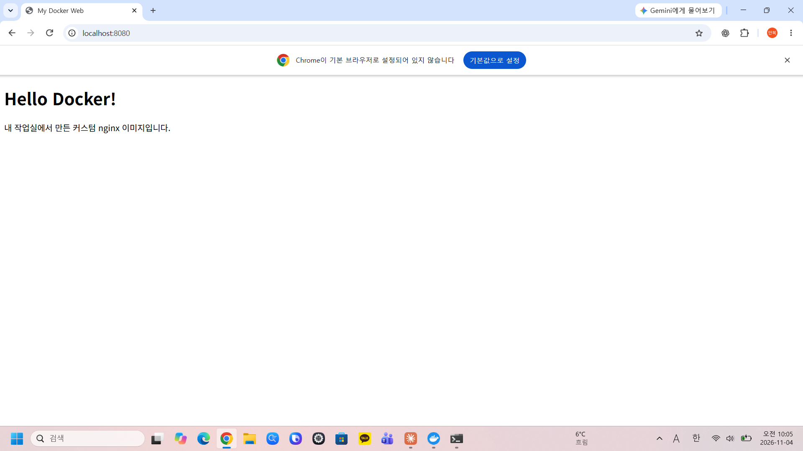
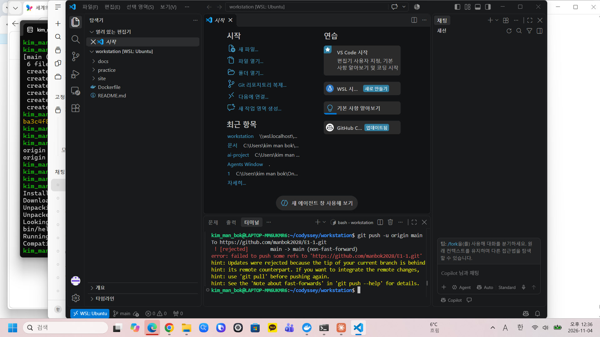
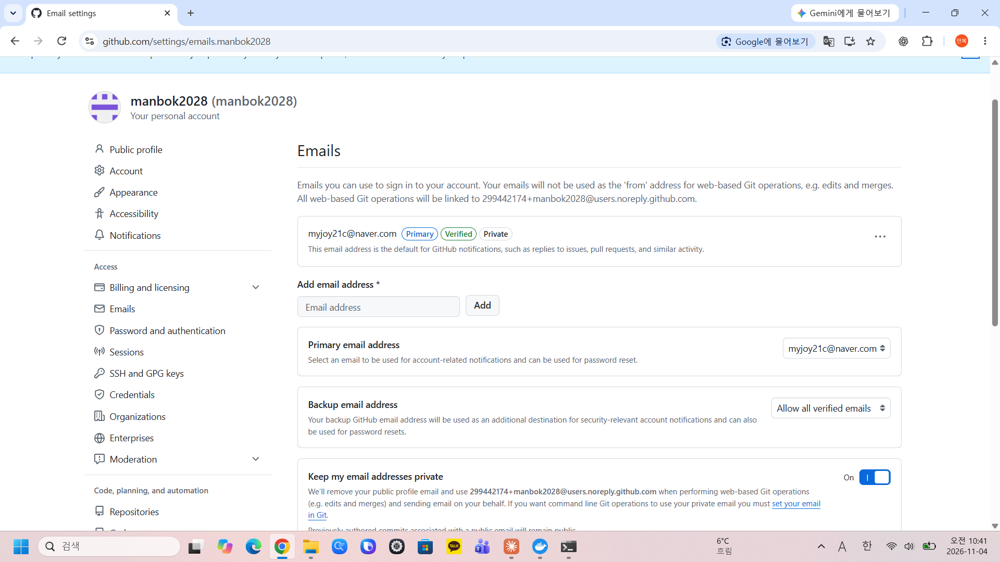

# 🐳 Docker 웹서버 실습

## 📌 실습 환경
- OS: Windows
- Docker: v29.9.2
- VS Code: v1.144.1

## 📋 실습 내용
- Dockerfile 작성 및 이미지 빌드
- 포트 매핑 (8080:80, 8081:80)
- 바인드 마운트로 호스트 파일 연결
- 볼륨을 활용한 데이터 영속성 확인
- Git 실수 복구 (커밋 되돌리기)

## 🖼️ 실습 결과 스크린샷

### 1. Docker Hello World


### 2. 포트 매핑 (8080)


### 3. 바인드 마운트 성공


### 4. 볼륨 영속성 확인


### 5. Git 실수 복구


## 💻 사용 명령어
```bash
# 이미지 빌드
docker build -t my-web:1.0 .

# 포트 매핑 실행
docker run -d -p 8080:80 --name my-web1 my-web:1.0

# 바인드 마운트 실행
docker run -d -p 8082:80 --name my-web-bind \
  -v C:\Users\kim man bok\dev-workstation:/usr/share/nginx/html \
  my-web:1.0

# 볼륨 실행
docker run -d -p 8083:80 --name my-web-volume2 \
  -v my-web-data:/usr/share/nginx/html \
  my-web:1.0